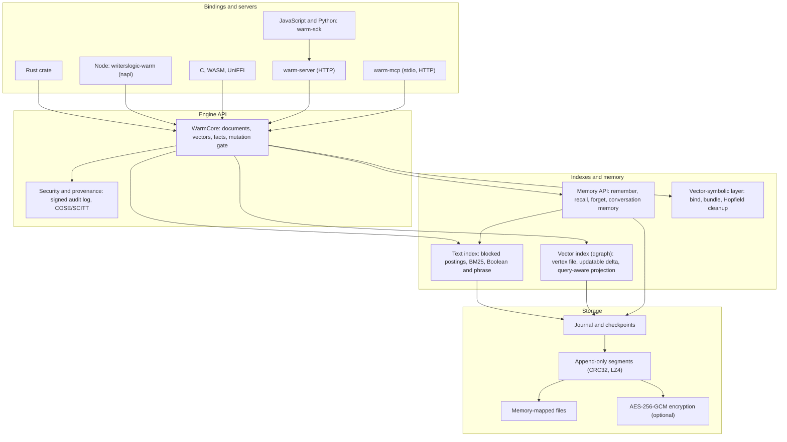
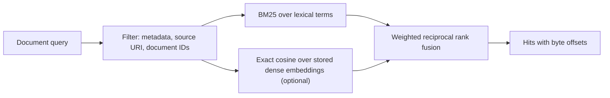

# Architecture

## System overview



## Module Graph

```
lib.rs                          Public Rust exports and module declarations
  |
  bindings/
  +-- node/                     Node.js bindings, configuration, DTOs and local embedder
  +-- python/                   PyO3 entry point, vector indexes and phase-vector bindings
  |
  tests/                        Engine, security, meaning and export tests
  |
  bin/                          Shipped command-line tools and servers
  +-- research/                 Benchmark, diagnostic and experiment executables
  |
  core/
  +-- engine/
  |   +-- mod.rs                WarmCore: main orchestrator
  |   +-- mutation.rs           Validated, logged transactions and replay
  |   +-- document_api.rs       Document lifecycle and bounded batches
  |   +-- query.rs              Query routing and execution
  |   +-- router.rs             Adaptive retrieval strategy selection
  |   +-- shard.rs              ShardSet, ShardManager, Shard
  |   +-- concepts.rs           Concept synthesis (clustering + bundling)
  |   +-- knowledge.rs          Triplets, sequences, analogies
  |   +-- structural.rs         Fuzzy structural queries (algebraic + materialized)
  |   +-- multi_hop.rs          Multi-hop reasoning (rule rewrite + chained lookup)
  |
  +-- cognition/
  |   +-- mod.rs                CognitionLoop: background discovery engine
  |   +-- patterns.rs           PatternScanner: relation co-occurrence analysis
  |   +-- abstraction.rs        AbstractionEngine: prototype concept discovery
  |   +-- gaps.rs               GapDetector: epistemic gap detection
  |   +-- hypothesis.rs         HypothesisEngine: gap-filler proposals
  |   +-- analogy.rs            AnalogyDetector: structural isomorphism
  |   +-- governor.rs           MemoryGovernor: dedup, forgetting, IDF refresh
  |   +-- refiner.rs            DistributionalRefiner: self-organizing atom vectors
  |   +-- loop.rs               Background thread lifecycle
  |
  +-- agency/
  |   +-- mod.rs                Goal-directed reasoning layer
  |   +-- goals.rs              Goal definition and lifecycle
  |   +-- planner.rs            Plan generation from goals
  |   +-- questions.rs          Question generation for knowledge gaps
  |   +-- self_modify.rs        Self-modification proposals
  |
  +-- entangled.rs              EntangledHVec: sparse binary hypervector type
  +-- encoding.rs               Text -> sparse vector (multiscale words and character n-grams)
  +-- experimental/             Opt-in codebooks, block codes, Bloom memory and phase graphs
  +-- hopfield.rs               Modern Hopfield network with sparse softmax
  +-- phase_resonator.rs        Resonator network for symbolic factorization
  +-- decompose.rs              Decomposer: vector decomposition
  +-- graph.rs                  Graph engine: typed relations, multi-hop BFS, temporal
  +-- documents.rs              Chunking, stemmed BM25, metadata filters, BM25/cosine score blend
  +-- schema.rs                 Store and embedding-space compatibility
  +-- durable_file.rs           Flushed atomic file publication
  +-- storage.rs                PersistentArena: mmap segmented log and generations
  +-- config.rs                 WarmConfig, MeaningConfig, CognitionConfig, and sub-configs
  +-- security.rs               SigningManager, EncryptionManager (feature-gated)
  +-- audit.rs                  AuditLog: append-only operation log
  +-- diffusion.rs              DiffusionFactorizer: score-based vector decomposition
  +-- text.rs                   TextProcessor: readability metrics
  +-- types.rs                  Shared types (RetrievalResult, ConceptCandidate, etc.)
  +-- error.rs                  WarmError enum
  +-- intersection.rs           Sparse sorted-merge intersection
  +-- atom_memory.rs            AtomMemory: concept vector store (meaning memory)
  +-- composite_memory.rs       CompositeMemory: role-bound composite vectors
  +-- triple_store.rs           TripleStore: symbolic (S, R, O) index
  +-- role.rs                   RoleRegistry: role-shift algebra
  +-- rules.rs                  RuleStore: composition rule definitions
  +-- admission.rs              AdmissionControl: fan-out gating
  +-- indexed_memory.rs         IndexedMemory: posting + IDF substrate
  +-- posting.rs                PostingShard: per-dimension posting lists
  +-- idf.rs                    IdfWeights: IDF with proportional clipping
  +-- tombstone.rs              TombstoneMap: soft-delete tracking
  +-- index/
  |   +-- mod.rs                Index traits
  |   +-- inverted.rs           Sparse inverted index for high-sparsity queries
  +-- ivf/
  |   +-- mod.rs                IVFIndex: inverted file with product quantization
  |   +-- training.rs           IVF training pipeline
  |   +-- query.rs              IVF query execution
  |   +-- kmeans.rs             K-means clustering
  |   +-- pq.rs                 Product quantization
  |   +-- nystrom.rs            Nystrom dimensionality reduction
  |   +-- inverted_list.rs      Inverted list storage
  +-- nsg/
      +-- mod.rs                NSGIndex: navigable small-world graph
      +-- training.rs           NSG construction
      +-- search.rs             Greedy graph search
      +-- graph.rs              Graph operations (KNN, pruning, centroid)
```

The crate root keeps the existing public Rust exports. Experimental modules live under `core/experimental/`, and their existing `core::module_name` imports remain available through re-exports. Cargo keeps every binary name and required feature unchanged; historical benchmark manifests retain the paths at their measured revisions.

## Meaning Memory Module Graph

Files are described in the module graph above; this is how `WarmCore` (`engine/mod.rs`) wires them.

| Component | Role |
|---|---|
| `AtomMemory` and `CompositeMemory` | Concept vectors and role-bound triple vectors; both sit on the shared `IndexedMemory` substrate (`PostingShard` per-dimension posting lists, `IdfWeights` with proportional clipping, `TombstoneMap` soft deletes) |
| `TripleStore` | Symbolic (S, R, O) index: four-way FxHash index `by_subject`, `by_relation`, `by_object`, `by_composite` |
| `RoleRegistry` | Role to cyclic-shift mapping: `compose()`, `unbind()`, `compose_triple()` |
| `RuleStore` | `CompositionRule` definitions mapping relation chains to derived relations |
| `AdmissionControl` | Fan-out gating: algebraic versus `MaterializedLookup` |
| `Decomposer` | Vector decomposition |
| `engine/structural.rs`, `engine/multi_hop.rs` | `fuzzy_structural_query()` (algebraic + materialized paths); `multi_hop_query()` (rule rewrite + chained lookup) |

### Data Flow: Structural Query

```
fuzzy_structural_query(known_bindings, target_role)
  -> RoleRegistry.compose(known)          // build partial query vector
  -> CompositeMemory.overlap_scan(query)  // IDF-weighted posting intersection
  -> AdmissionControl.check(fan_out)      // gate on candidate count
     |
     +-- Algebraic path (fan_out <= limit):
     |   -> composite.bind(query)         // XOR-unbind known roles
     |   -> permute(dim - target_shift)   // inverse cyclic shift
     |   -> hopfield_cleanup(residual)    // attractor network recovery
     |      -> overlap_scan + sparse_softmax + iterate
     |   -> return (entity_id, confidence)
     |
     +-- Materialized path (fan_out > limit):
         -> TripleStore.by_composite_id() // symbolic index lookup
         -> extract target_role field
         -> return (entity_id, score)
```

### Data Flow: Multi-Hop Query

```
multi_hop_query(start, [rel1, rel2, ...], ctx, rule_store)
  -> if single relation:
       single_hop -> fuzzy_structural_query
  -> if two relations + matching CompositionRule:
       rule_rewrite -> fuzzy_structural_query(derived_relation)
  -> else:
       chained_lookup -> TripleStore walk, hop by hop
```

## Transactions and lock ordering

Persistent vector, document, graph, triple and rule mutations take `mutation_gate.write()` before the shard/component locks; main vector, document, structural and graph queries take its read lock. A mutation validates its complete operation list, logs one framed transaction, then applies every operation to memory. The gate also serializes compaction and index publication. Audit and provenance sidecars are separate operations after the main transaction.

Within a shard, vector/registry/posting changes and cache invalidation follow the shard's lock
order. Index training copies a consistent snapshot, releases the gate while training, then
checks the revision before publishing. A stale training run returns an explicit retry error.

## Write and recovery paths

```text
public mutation
  -> validate dimensions, identifiers, limits, and complete operation list
  -> acquire transaction write gate and shard write lock
  -> serialize HMS-TXN-2 + typed mutations as one record
  -> optional authenticated encryption
  -> CRC-framed append and mmap flush
  -> apply vectors, postings, documents, triples, relations, and rule changes
  -> increment data revision
```

Recovery validates the schema before opening data, resolves the active `CURRENT` generation,
validates arena frames, decrypts authenticated payloads when configured, and replays typed
transactions in order. Main-data decryption/replay failures are errors. ANN caches are optional:
only checksummed files with matching shard topology and arena checkpoints are loaded. Invalid
or stale caches are discarded; inverted indices are reconstructed from live vectors.

## Compaction

Compaction excludes persistent mutations and main queries. It snapshots live vectors, documents, atoms, composites, triples, relation types, relations, rules and derived-fact ownership into a new arena, flushes and verifies it, installs a generation directory, then publishes `CURRENT` by atomic file replacement; old files are cleaned up only after publication, so an interruption selects either the complete old or complete new generation. Directory publication is synced on Unix; platform limits are in [production-readiness.md](production-readiness.md); stages and budgets in [file-format/COMPACTION.md](file-format/COMPACTION.md).

Document and meaning-derived chunk IDs have reserved prefixes. Updating or deleting a document removes its owned chunks. Replacing or deleting a meaning source removes its owned inferred triples (the ownership mapping survives compaction and recovery). Explicit triplet replacement removes the prior structural record before inserting the new one.

## Retrieval paths



- Sparse vector queries use the adaptive router to select brute-force, inverted, NSG or IVF retrieval. Replacements and deletions update postings incrementally, reuse slots and invalidate incompatible ANN caches. No training is hidden inside ingestion: `indexStatus` reports recommendations and the application schedules `maintainIndices`.
- The document path (diagram above) currently scans eligible chunks; it does not use the sparse ANN graph as a dense-vector approximation. The optional JavaScript adapter embeds queries locally and reranks candidates with a local ONNX cross-encoder.
- `semantic.js` batches model inference and provides a bounded operation queue; async iterable ingestion awaits each document, preventing unbounded pending native/model work. Model identity, artifact revision, preprocessing fingerprint, dimensions, normalization and metric must match the store's embedding space.

## Validation

| Test | Covers |
|---|---|
| `tests/reliability.rs` | signed projections, structural answers, durable deletes, ANN restart/corruption handling, concurrent writes/compaction |
| `tests/documents.rs` | source offsets, filters, versions, semantic candidates, bounded ingestion, atomic source migration |
| Storage unit tests | child-process exits injected around compaction publication |
| Native Node tests | actual CJS/ESM bindings, encryption failure, file ingestion, queue backpressure |
| Packed-install smoke test | the distributable native module and document adapter load |
